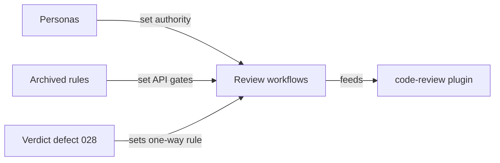
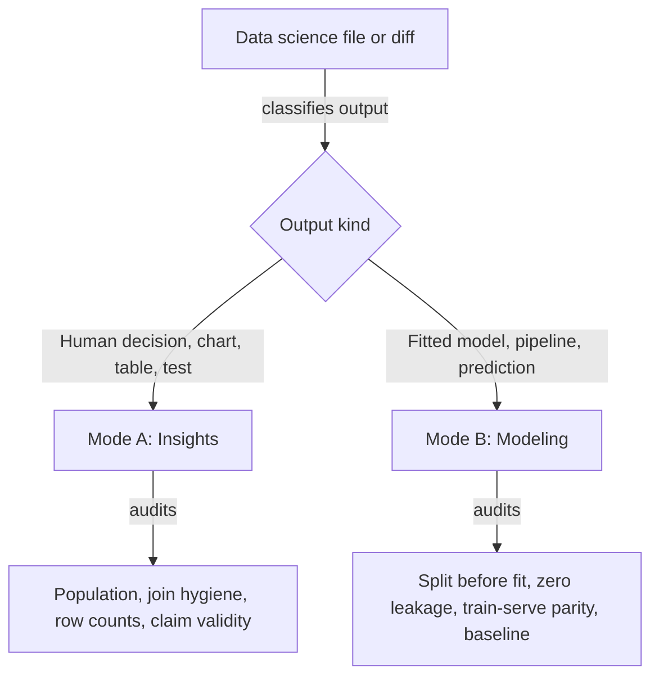

# Code review plugin research

`gwrk` ships personified review mechanics and a closed-loop finding format, while its domain review prompts remain CLI-only copies. The new `code-review` plugin keeps `gwrk`'s verdict rules and adds specialist skills for webapp, API and data science code. Blocked: none. David Gonzalez (repository owner) owns the plugin.

## What gwrk has now and in the archive

| Asset in `gwrk` | State | What survives into `code-review` | What is missing |
|---|---|---|---|
| `builtins/personas/principal-engineer.md` | Current | Principal Engineer stance and terminal `GO` or `NO-GO` authority | Tied to `make up` and `Zod` only |
| `builtins/personas/product-manager.md` | Current | Separation of code review from User Acceptance Testing (UAT) | Browser UAT only |
| `builtins/personas/senior-dev.md` | Current | Rule that implementers never issue a verdict | Execution loop only |
| `builtins/reviews/review-code-cli/PROMPT.md` | Current | One-way gate authority and `WHERE` finding block | Hardcoded to `pnpm` and CLI |
| `builtins/reviews/review-code-webapp/PROMPT.md` | Current | Same 10-step gate and finding flow | Verbatim copy of CLI prompt (defect D7) |
| `docs/code-review-verdict-defect.md` | Current | Proof that a green gate over a defect is a gate hole | `tasks.json` specific |
| `7136542b:.agents/rules/api-architecture.md` | Archived | Six REST and bounded-context gates | Deleted from active tree |
| `7136542b:.agents/workflows/review-code.md` | Archived | Original fullstack review loop with end-to-end gate | Replaced during CLI pivot |
| `src/plugins/review-plugin.ts` | Current | Project type detection before review dispatch | Detects only `cli` or `webapp` |
| `src/engine/profile-detector.ts` | Current | Filesystem detection for language and test runner | Detects stack, not architecture |

### Five mechanics from gwrk

1. Persona separation. The Principal Engineer owns code review and architectural integrity. The Product Manager owns UAT and user story validation. Code review never grades visual polish, and UAT never grades internal layering.
2. Read-only reviewer. The reviewer never edits source code to fix a defect. It records findings and returns `GO` or `NO-GO`.
3. One-way gate authority. Passing tests or gates never erase a defect reproduced in review. A green test suite over a real defect means the test suite has a coverage hole.
4. Structured remediation block. Every finding records `WHERE` and `EXPECTED` alongside `ACTUAL`, `FIX` and `GATE`. An implementer or agent can act on the finding without re-reading the whole repo.
5. Detect then dispatch. A router inspects the changed files and project markers before selecting the review rubric.

## Wide search findings by code kind

### Fullstack webapp review

Webapp reviews fail when they check framework idioms instead of boundary rules. Four boundary defects recur across Clean Architecture, Hexagonal Architecture (Ports and Adapters) and Model-View-ViewModel (MVVM).

| Pattern | Core rule | Primary defect | What the reviewer checks |
|---|---|---|---|
| Clean Architecture | Dependencies point inward toward domain entities | Domain imports UI or database libraries | Zero framework, HTTP or Object-Relational Mapping (ORM) imports in domain |
| Hexagonal | Application core talks to the outside only through ports | Use case calls a concrete fetch or storage client | Inbound and outbound ports live inside core; adapters live outside |
| MVVM | View renders state; ViewModel owns presentation logic; Model owns domain | Fat View or View-Aware ViewModel | Zero network calls or business branching in View; zero Document Object Model (DOM) references in ViewModel |
| Model-View-Controller (MVC) and Vertical Slice | Each slice or controller coordinates one flow without cross-slice reach-in | Raw persistence shapes passed straight to the View | Explicit mapping between transport Data Transfer Objects (DTOs), domain models and UI state |

Fullstack webapp reviews also check four UI state invariants from `gwrk`'s UAT history. Views and ViewModels must model `loading` and `empty` alongside `error` and `success` states. Optimistic updates must roll back on failure.

### API review

Language-agnostic API review joins Hexagonal isolation with the six principles in `gwrk`'s archived `api-architecture.md`.

| Layer or surface | Rule | Blocking defect |
|---|---|---|
| Domain core | Pure business rules and entity invariants | HTTP status codes, web context or database table annotations inside domain |
| Application use cases | One business action per use case via ports | Business calculations inside controllers or direct driver calls in use cases |
| Driving adapters | Thin translation from wire to inbound port | Missing boundary schema validation or domain entities serialized straight to the wire |
| Driven adapters | Implement outbound ports defined by core | ORM entities or SQL errors leaking out of the repository |
| REST resource design | Resource nouns inside one bounded context | Action verbs in URLs, cross-domain reach-in or duplicate route files for one resource |
| Error and runtime contract | Deterministic error envelope and safe retries | Raw stack traces on 500s, missing idempotency on mutations, N+1 queries or unbounded lists |

### Data science review

Data science code fails in two different ways depending on its goal. Mixing exploratory insight code with production modeling code hides both classes of bugs.

| Dimension | Mode A: Insights code | Mode B: Modeling and predictions code |
|---|---|---|
| Goal | Answer a question with a number, chart or statistical test | Produce a generalizable model or live prediction |
| Primary silent bug | Silent row loss or duplication across joins and filters | Data leakage from validation, test or future timestamps |
| Data hygiene check | Assert row count and distinct entity count before and after every join or filter | Fit scalers, imputers, encoders and vocabularies on the training split only |
| Time and grouping | State the exact date window, population and exclusion rules | Use chronological splits for time data and group splits for multi-row entities |
| Validation standard | Check distribution shape, sample power, uncertainty intervals and confounders | Beat a naive baseline on a metric matched to class balance and business cost |
| Production contract | Fresh-kernel top-to-bottom run with every prose number traced to code | Shared feature code between training and serving, pinned seeds and schema handling for unseen categories |

## Plugin design

The new `code-review` plugin in `plugins/code-review/` ships four skills.

| Skill | Role | Three reasoning passes |
|---|---|---|
| `code-review` | Classify changed code, run mechanical baseline, dispatch specialist skills | Analytical, Audit, Integrative |
| `review-webapp` | Review fullstack webapp code by architectural pattern | Analytical, Audit, Adversarial |
| `review-api` | Review API code across Clean, Hexagonal and REST rules | Analytical, Audit, Stress-Testing |
| `review-data-science` | Review data science code as Insights or Modeling | Analytical, Forensic, Skeptic |
