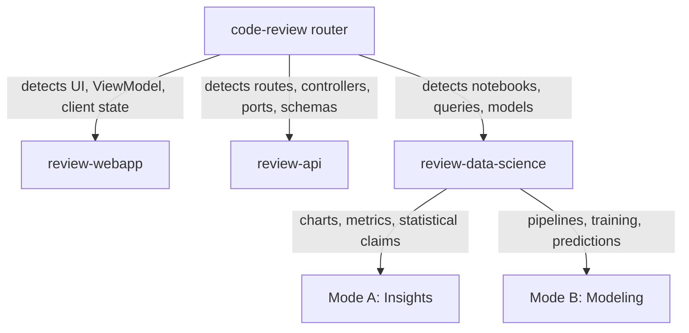

# code-review

Principal Engineer code review skills built on `gwrk`'s gate and verdict mechanics. The router classifies the code under review and dispatches specialist skills for fullstack webapps, APIs and data science.

```
/plugin install code-review --marketplace dgonzo/dgonzo-plugins
```

Install instructions for Claude and Antigravity are in [INSTALL.md](../../INSTALL.md). Codex and ChatGPT setup is there too.

## How routing works



## Skills

| Skill | Focus | Opinion posture |
|---|---|---|
| `code-review` | Identify code kind, run mechanical gates, dispatch specialist reviews | Enforces one-way gate authority and `GO` or `NO-GO` verdicts |
| `review-webapp` | Fullstack webapp boundaries: Clean, Hexagonal, Model-View-ViewModel (MVVM) and Vertical Slice | Framework-agnostic; strict on layer separation and UI state |
| `review-api` | API boundaries: Clean, Hexagonal, REST resource design and bounded contexts | Language-agnostic; strict on inward dependencies and wire schemas |
| `review-data-science` | Data science code split into Insights vs Modeling and Predictions | Opinionated; strict on join hygiene, row counts and zero leakage |

## Core mechanics from gwrk

| Mechanic | Rule |
|---|---|
| Persona boundary | Principal Engineer reviews code and architecture; Product Manager owns User Acceptance Testing (UAT) |
| Read-only reviewer | Reports findings and `GO` or `NO-GO`; never edits source files to fix defects |
| One-way gate authority | A green test or gate never closes a reproduced defect; it exposes a coverage hole |
| Structured findings | Every blocking finding records `WHERE`, `EXPECTED`, `ACTUAL`, `FIX` and `GATE` |
