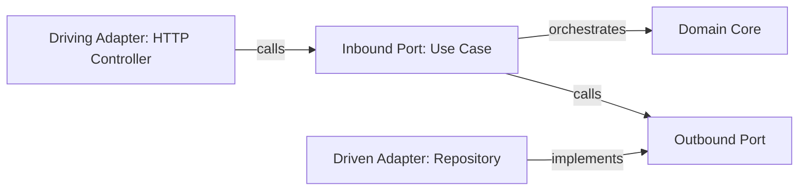

# API architecture and REST rubric

Language-agnostic boundary rules for `review-api`. Combines Hexagonal Architecture with `gwrk`'s six API governance principles.

## Hexagonal and Clean flow

| Layer | Owns | Forbidden imports and contents |
|---|---|---|
| Driving Adapter | HTTP routing, status codes, wire DTO validation, auth token extraction | Domain business rules, direct SQL or ORM queries |
| Inbound Port and Use Case | One business transaction, coordination across domain and outbound ports | HTTP request or response types, status codes, concrete DB drivers |
| Domain Core | Entities, aggregates, value objects, domain invariants and domain errors | Web frameworks, ORM table annotations, JSON wire tags, logging transports |
| Outbound Port | Interface contracts required by the core (`UserRepository`, `PaymentGateway`) | Concrete client implementations or driver-specific types |
| Driven Adapter | SQL, ORM, external HTTP client, queue producer, persistence mapping | Business branching, HTTP controller types, unmapped ORM entities returned to core |

## Six REST governance rules from gwrk

| Rule | Requirement | Check |
|---|---|---|
| `P1` Bounded contexts | One API namespace per domain context; aggregates stay inside their owning domain | Reject routes that mutate or join tables belonging to another domain directly |
| `P2` Single route owner | Each resource has one route handler file owning its operations | Search existing routes before adding a handler; reject duplicate resource files |
| `P3` Resource-oriented URLs | Paths name nouns (`/api/{domain}/{resource}/:id/{sub-resource}`) | Reject action URLs (`/api/do-something`) and journey URLs (`/api/checkout-step-2/pay`) |
| `P4` Focused handler size | Route and controller files stay under 400 lines and one responsibility | Split oversized files into CRUD vs domain sub-resource handlers |
| `P5` Boundary schema enforcement | Every route defines explicit request and response schemas (`200`, `400`, `404`) | Reject routes with untyped bodies or missing response validation schemas |
| `P6` Standard error envelope | All errors map domain exceptions to HTTP status codes in one envelope (`{ error, code, details }`) | Reject generic `500` pass-throughs, ad-hoc error shapes or leaked SQL and stack traces |

## Blocking anti-patterns

| Code | Name | What it looks like | Required fix |
|---|---|---|---|
| `API-01` | Core Transport Leak | Domain or Use Case imports HTTP status codes, web context or framework exceptions | Raise a domain error in Core; map it to an HTTP status code in the Driving Adapter |
| `API-02` | Core Persistence Leak | Domain entity carries ORM table annotations or Use Case imports a database client directly | Define an Outbound Port in Core and move ORM models and queries to the Driven Adapter |
| `API-03` | Fat Controller | Route handler computes business rules, state transitions or multi-repository workflows | Extract a single-purpose Use Case and keep the controller as a thin wire translator |
| `API-04` | Entity on the Wire | Controller returns a database model or internal domain entity directly as JSON | Map to an explicit wire Response DTO validated by a boundary schema |
| `API-05` | Action or Scattered Route | RPC verb in URL path or a second handler file created for an existing resource | Consolidate under the resource's owning route file using standard HTTP methods |
| `API-06` | Unsafe Mutation | `POST` or `PATCH` performs external calls inside a DB transaction or lacks retry safety | Move external network calls outside the DB transaction and guard retries with idempotency |
| `API-07` | Unbounded Query or N+1 | List endpoint has no pagination cap or loops over a repository query per item | Enforce a maximum page size and batch queries through the Outbound Port |
| `API-08` | Incomplete Route Tests | Route test checks `200` only and omits `400`, `401` or `403`, and `404` cases | Add boundary tests for validation failure, unauthorized access and missing resource |
