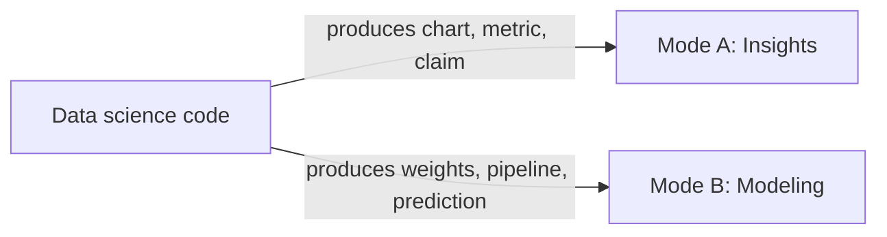

# Data science review rubric: Insights vs Modeling

Opinionated classification and audit rules for `review-data-science`.

## Mode classification

| Dimension | Mode A: Insights code | Mode B: Modeling and predictions code |
|---|---|---|
| Output artifact | Table, chart, metric, hypothesis test or memo claim | Fitted estimator, feature pipeline, evaluation report or prediction |
| Primary failure | Silent row inflation or drop, biased denominator or ungrounded claim | Data leakage, improper split, train-serve skew or uncalibrated metric |
| Required assertions | Row count and distinct entity count before and after every join or filter | Split isolation, fit-on-train-only, point-in-time joins and seed pinning |

## Blocking anti-patterns: cross-mode

| Code | Name | What it looks like | Required fix |
|---|---|---|---|
| `DS-01` | Mixed Mode File | One notebook or script runs ad-hoc EDA mutations and also trains or serves a production model | Split exploratory insight notebooks from deterministic feature and training modules |

## Blocking anti-patterns: Mode A (Insights)

| Code | Name | What it looks like | Required fix |
|---|---|---|---|
| `INS-01` | Unchecked Join Cardinality | `merge` or `JOIN` runs without `validate="one_to_one"` or `one_to_many` and without before-and-after row counts | Declare expected cardinality and assert row count and unique entity IDs before and after |
| `INS-02` | Silent Filter Drop | Filter or `INNER JOIN` drops nulls or unmatched rows without logging how many records and entities vanished | Log or assert dropped row share and check whether missingness correlates with the outcome |
| `INS-03` | Mixed Population Join | Two sources with different populations share a metric without a sources table and explicit join key | Add a sources table naming source, population, contents and join key per `writing:writing-standard` Rule 13 |
| `INS-04` | Point Estimate Without Uncertainty | Report states a mean, lift or p-value without sample size `n`, confidence interval or distribution check | Report sample size `n` and uncertainty bounds; use median and interquartile range on skewed data |
| `INS-05` | Causal Claim From Correlation | Observational comparison claims feature X caused change Y without controlling confounders or selection bias | State the associative finding plainly or document the causal identification design and its checks |
| `INS-06` | Untraceable or Out-of-Order Notebook | Notebook cells execute out of order, mutate globals across cells or produce numbers that differ from prose | Restart kernel, run top-to-bottom cleanly and compute every reported number directly in code |

## Blocking anti-patterns: Mode B (Modeling and Predictions)

| Code | Name | What it looks like | Required fix |
|---|---|---|---|
| `MOD-01` | Pre-Split Transform Leakage | `fillna(df.mean())`, `StandardScaler().fit_transform(X)`, vocabulary build or target encoding runs before `train_test_split` | Split first; wrap all transforms in a `Pipeline` fit strictly on `X_train` or inside cross-validation folds |
| `MOD-02` | Post-Event Target Leakage | Feature set includes columns populated after the prediction timestamp or derived from the target outcome | Remove post-event columns and verify every feature exists prior to the inference trigger time |
| `MOD-03` | Random Split on Temporal or Grouped Data | Time-series or event log uses `train_test_split(shuffle=True)` or multi-row entity data uses standard `KFold` | Use chronological or rolling-window splits for time data and `GroupKFold` by entity ID for grouped rows |
| `MOD-04` | Point-in-Time Join Leak | Historical feature join aggregates over a table without filtering feature timestamps to `<= event_timestamp` | Use an as-of or point-in-time join so features read only records known at prediction time |
| `MOD-05` | Train-Serve Feature Skew | Training computes features in Pandas while serving reimplements them in SQL or another language | Extract one shared feature transformation module or feature store definition used by both paths |
| `MOD-06` | Unhandled Unseen Inference Input | Inference pipeline crashes on unseen categorical levels, null values or out-of-range numeric inputs | Configure explicit unknown-category handling, imputation defaults and input schema validation |
| `MOD-07` | Missing Baseline or Wrong Metric | Model reports raw accuracy on imbalanced classes or claims lift without a naive heuristic baseline | Benchmark against a naive baseline and evaluate with precision-recall, calibration or cost-weighted metrics |
| `MOD-08` | Test Set Peeking or Unpinned Run | Hyperparameters or thresholds are tuned on the final test set, or random seeds and data versions are unpinned | Tune on a validation split or nested CV only, evaluate on held-out test once and pin all random seeds |
