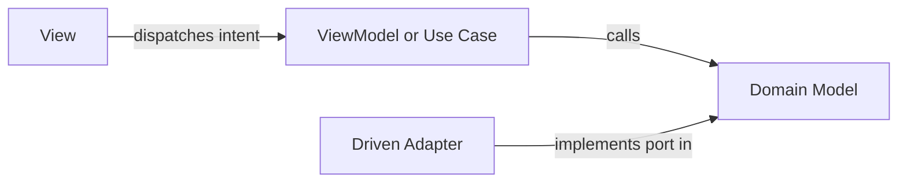

# Fullstack webapp architecture rubric

Pattern detection and boundary rules for `review-webapp`.

## Architecture pattern detection

| Pattern | Directory and file signals | Import direction rule |
|---|---|---|
| Clean Architecture | `domain/`, `application/` or `use-cases/`, `infrastructure/`, `presentation/` | Presentation and Infrastructure import Application and Domain; Domain imports nothing |
| Hexagonal (Ports and Adapters) | `core/`, `ports/` (`inbound/`, `outbound/`), `adapters/` (`ui/`, `http/`, `persistence/`) | Adapters import Ports and Core; Core never imports Adapters |
| Model-View-ViewModel (MVVM) | `views/` or `components/`, `viewmodels/` or `hooks/` or `stores/`, `models/` or `services/` | View imports ViewModel; ViewModel imports Model; Model never imports ViewModel or View |
| Model-View-Controller (MVC) | `models/`, `views/`, `controllers/` | Controller coordinates Model and View; View never mutates Model directly |
| Vertical Slice | `features/<slice>/` with internal `ui`, `model`, `api` submodules | Slices isolate internals; cross-slice calls go through public slice contracts only |

If a codebase mixes folder names, evaluate it against the closest matching table row. State the inferred layer mapping in the report.

## Blocking anti-patterns

| Code | Name | What it looks like | Required fix |
|---|---|---|---|
| `WEB-01` | Fat View | View component runs `fetch`, SQL, data aggregation or pricing and permission rules | Move fetch and orchestration to ViewModel or Use Case; pass ready-to-render state to View |
| `WEB-02` | View-Aware ViewModel | ViewModel or hook reads DOM nodes, calls router navigation directly on DOM events or imports UI widgets | Expose reactive state or command callbacks; let the View bind DOM side effects |
| `WEB-03` | DTO Bleed | Raw API response or ORM entity passes straight into the View without mapping | Map wire DTOs to domain or presentation models at the adapter or ViewModel boundary |
| `WEB-04` | Domain Impurity | Domain entity or value object imports a UI framework, HTTP client or ORM decorator | Strip external imports from Domain; move persistence and transport tags to Adapters |
| `WEB-05` | Adapter Decision Leak | Persistence or HTTP adapter branches on business rules instead of translating data shapes | Move the business rule into the Domain or Use Case; keep the adapter as a pure translator |
| `WEB-06` | God ViewModel | One ViewModel or store manages unrelated screens, forms, caching and transport | Split by user flow or bounded feature; extract shared domain logic into a service |
| `WEB-07` | Incomplete Async State | Async view handles the happy path only and omits `loading`, `empty` or `error` state | Model all four states (`loading`, `empty`, `error`, `success`) explicitly in the ViewModel |
| `WEB-08` | Unbounded Side Effect | Subscription, interval, listener or inflight fetch has no teardown or abort path | Cancel or unsubscribe on component teardown and guard against stale async resolution |
| `WEB-09` | Unrecoverable Optimistic Update | UI mutates local state optimistically with no snapshot rollback when the server call fails | Capture previous state before mutation, restore on error and surface failure to the user |
| `WEB-10` | Client-Only Gate | Authorization or invariant validation runs in the View or ViewModel but is absent on the server | Enforce the invariant in the server Use Case or Domain layer; keep client checks for feedback only |
