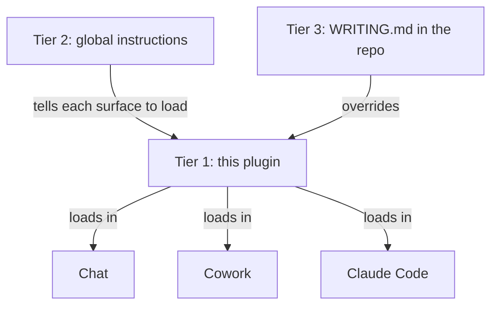

# writing

The house writing standard, as one plugin for every surface. Session habits moved to the `dgonzo` plugin in 3.0.0. Project tweaks live in a `WRITING.md` at the repo root.

```
/plugin install writing --marketplace dgonzo/dgonzo-plugins
```

Cowork, team repos and release files are in [INSTALL.md](../../INSTALL.md).

## The tiers



| Tier | Where it lives | Contents |
|---|---|---|
| 1 plugin | this repo, installed from claude.ai | the full rules, the card, the linter, the hooks |
| 2 global instruction | Cowork settings, chat preferences, `~/.claude/CLAUDE.md` | two lines that say load the plugin |
| 3 project | `WRITING.md` at the repo root | audience, project terms, a rule added or relaxed, a project linter |

## What the plugin contains

| Component | Name | Job |
|---|---|---|
| Skill | `writing-standard` | the prose rules and the check before you send |
| Skill | `improve-readability` | review one file, report findings, never edit |
| Skill | `review-prose` | review a diff, a ref or a PR, report findings, never edit |
| Skill | `lint` | run the linter on one file and print its output |
| Card | `standard/card.md` | the short rules, loaded at session start and via `rules/AGENTS.md` |
| Script | `scripts/writing_lint.py` | the mechanical rules, exit 0 always |
| Hook | SessionStart | prints the card into the session context in Claude |
| Hook | PostToolUse | lints every Markdown file an agent writes and feeds findings back |

The hooks run in Claude Code, in Cowork sessions on your computer in Antigravity and in local Codex after hook trust review. Cloud ChatGPT relies on the skills alone.

## Tier 2: the global instruction

Paste this block into Cowork global instructions and into claude.ai preferences. Keep it in `~/.claude/CLAUDE.md` too. The fallback card ships with the plugin and the SessionStart hook loads it, so nothing else is pasted anywhere.

```markdown
Load the dgonzo:working-style and writing:writing-standard skills before the first reply in every session and follow them.

If a WRITING.md exists in the working folder, read it too.
```

## Tier 3: WRITING.md

A plain Markdown file at the repo root. The skills read it before writing and it wins on conflict. Keep it short. A template:

```markdown
# Writing overrides for this repo

Audience: <who reads the output of this repo>.
Terms: <project IDs and their plain names, or a link to a glossary>.
Added rules: <one per line, or none>.
Relaxed rules: <one per line, or none. Example: no Mermaid, draw diagrams as Unicode box-drawing>.
Project linter: <command, or none>.
```

## Measured effect

The plugin cuts linter findings from 3.4 to 0.9 per 100 words. Seven prompts ran twice each, once with only this plugin loaded and once in a bare `--safe-mode` session. Full method and outputs are in [the plugin-vs-naked eval](../../evals/plugin-vs-naked/README.md).

| Measure | With plugin | Bare session |
|---|---|---|
| Linter findings per 100 words | 0.9 | 3.4 |
| Long sentences | 4 | 43 |
| Outputs with a table | 12 of 16 | 2 of 16 |
| Mean words in first sentence | 12.6 | 21.2 |
| Cost for 14 runs | $1.52 | $1.17 |

The bare model already avoids em-dashes and praise openers, and it leads with the point. The plugin's gain is shorter sentences and more tables and diagrams.

## Updating the rules

Edit the skills here and bump `version` in `.claude-plugin/plugin.json`. Commit and push. Installed surfaces pick up the new version when their marketplace refreshes. See [INSTALL.md](../../INSTALL.md) for refresh commands. Run the linter on the skill files before you push.
